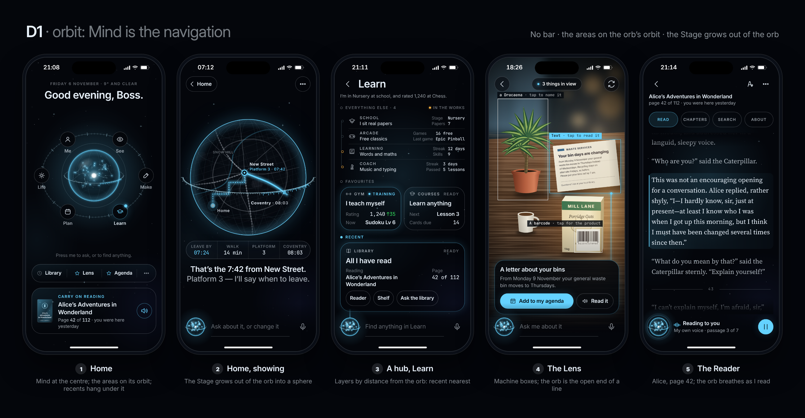

# D1 · Orbit: Mind is the navigation

No bar. The orb is the way in: the areas stand on its orbit, recents hang under it, a press opens the typed word, the Stage grows out of it.

## The design

D1 takes his sentence at its word ("the mind, like the middle thing") and makes the middle thing the only chrome. On Home the orb sits at
the centre of its own sky; the six areas (See, Make, Learn, Plan, Life, Me) stand on an orbit round it as named, labelled stations, the
one that matters tonight lit (Learn, because the evening read lives there); recents and favourites hang directly under it in one
capsule; a line says what the orb does ("Press me to ask, or to find anything."). A press on the orb opens the typed word; a tap on
a station opens its layer. On every other screen there is no bar and no tab: the orb sits bottom left as the **open end of a line**
(press it to type; hold it and the areas open round it, as the quick switcher's arc does today), and what is nearest to it is what he
uses most: a hub stacks its layers by distance from the orb, the recent card at the bottom on a thread from the orb, the favourites
above it, the rest above them as stations along an orbit line. The language is light, not glass: a thing is an outline and a little
glow, depth is how near it is to the orb, nothing blurs and nothing casts a shadow. The Stage **grows out of the orb**: the orb
becomes a sphere with the picture inside it, its graticule over the map, its equator scale riding across in front, its rim lit;
Mind is not beside the Stage, it is the Stage's frame, and giving the Stage back is the orb shrinking again. It fits 44 screens
because the orbit only ever holds six things and the hub below it only ever three layers, so no screen is ever a wall; everything else is
a word away. It drops: the tab bar, the separate Ask bar, the four gauges, the deck as a page, the avatar chip (Me is a station), and
the switcher as a separate thing (it is the orb).

## The finding rule

Taps are counted from Home.

| What he wants | Taps | The path |
| --- | --- | --- |
| A recent screen (Library, God's eye, Brief) | **1** on Home, **2** from anywhere | Home: the capsule under the orb. Anywhere: press the orb (the typed word opens, Recent and Starred above it, nearest the orb), tap the screen |
| A favourite (Lens, Agenda, Gym, Courses) | **1** on Home for the first two, **2** otherwise | The starred items in the capsule, or the same layer from the orb |
| Any screen | **2** | The station on the orbit, then the card in the hub. Or one gesture: hold the orb, slide to the area, let go (the hub), then tap the card |
| A panel inside a screen | **3** | Station, card, panel. The recent card on a hub carries its panels as chips (Reader, Shelf, Ask the library) |
| Any of the 150 abilities | a word | Press the orb, type "chess", tap the first line. Two taps and a word, from anywhere |

The honest cost: from inside a screen, going to another area is Home plus a station (2 taps) or a hold-and-slide gesture; today's bar is 1 tap.
Someone who flips between Plan and Learn all day pays for that.

## The five-second test: where it holds and where it fails

What a stranger sees with no words from anyone: a glowing sphere, "Good evening, Boss.", six named places standing on a ring round
it, one of them lit, a line under it that says what the orb does, and one card that says "Carry on reading". Six labelled things
at 44 points on an orbit is as readable as a menu; **navigating passes the test**. **Typing does not pass without the line**: nothing about a
glowing sphere says "press me", so the hint line stays under it for as long as he is new (it can fade after ten presses) and the orb
carries a faint ring that says "this is a button". On every other screen the typed word is the only thing at the bottom and reads
as a field; but **moving between areas from inside a screen is not discoverable** (hold-and-slide has to be taught once, as the
switcher's long press was). Where D1 fails, plainly:

1. **Six is its ceiling.** The orbit holds six stations at 44 points with their labels on a 390 screen; a seventh area breaks the
   geometry. Life already took the sixth place; Me had to become a station.
2. **A circle is a map's shape.** The sphere suits a route, a globe, a chart, a plan. It clips a document, a tune's waveform and a
   3-D room's corners; for those the Stage should be D3's rounded rectangle with the same ring as its bezel. Plan for both.
3. **The hub reads upside down** against the usual order (the rest at the top, the recent card at the bottom, nearest the thumb).
   That is the point (nearest the orb), but it is a thing to learn, and on a tall phone the top of the hub is calm and empty.
4. **Gesture and iOS.** Press-and-hold must beat iOS's text selection and callout on every screen (`-webkit-touch-callout: none`,
   pointer events); the existing switcher is the precedent and it works.

## Honest costs

My estimates, in days of one strong-tier builder with a reviewer, from the line counts of today's code (`styles.css` 5,846 lines;
`switcher.ts` 189, `areas.ts` 541, `hubcards.ts` 1,017, `launcher.ts` 339, `core/index.ts` 958, `mind.ts` 997).

### The shell

| Piece | What it takes in D1 | Days |
| --- | --- | --- |
| Tokens and components | Tokens; the orbit, the station, the capsule, the thread, the orbit-line rows | 1.5 |
| Home | The orbit (SVG ring, six stations positioned from two variables), the press and drag, the lit station from the hour, the capsule, the hour's card; the four gauges go | 2 |
| Mind on every other screen | The orb as the open end of a line replaces the Ask bar and the tab bar; one component in `layout.ts` | 1.5 |
| The fan | Hold the orb and the areas open round it: `switcher.ts` (189 lines) is the starting point | 1 |
| Hubs in layers | `CARDS` stays; distance-from-orb stacking, the orbit line, the thread | 1.5 |
| The deck folded in | The typed layer lists screens and abilities; `launcher.ts` goes | 1 |
| Jump bar | It is the typed word | 0.5 |
| **The shell without the Stage** | | **9** |
| Mind with the Stage | A sphere clip, a graticule, a ring in front, a lit rim (CSS and SVG); plus a rounded-rectangle Stage for documents and rooms (point 2 above) | 3 |

### Every other screen

Chrome migration is one file: every screen loses its tab bar and gains the orb's line (`layout.ts`). Content migration is mid-sized:
cards stay cards but become outlines with a glow (drop 83 blurs and 536 shadows, keep the 608 radii as they are), so most screens
keep their layout. Estimate: one to two hours per dense screen, two to three weeks pass by pass. The expensive part is not CSS: it is
making the hold-to-fan reliable everywhere (Safari's callout, scrolling lists, the Lens's camera layer) and keeping the orb alive as a WebGL
canvas on every screen without costing battery (it is one shared canvas already, the hero adopts it; a 56-point version at the
foot of every screen is a second view of the same renderer).

## In this folder

`tokens.css` (the real tokens; Ember is the second block: a theme is a swap of the accent block alone, `home-ember-390.png` shows it),
`style.css`, `build.py` (`python3 -I -B docs/build-plan/mockups/directions/d1/build.py` from the repo root, then
`node docs/build-plan/mockups/tools/render.mjs directions/d1`), and the pictures: `home`, `show`, `hub`, `lens`, `reader` and
`shelf` (a sixth small frame) each at `-390.png` and `-440.png`, `home-ember-390.png` and `-440.png`, `contact.png`. The words are the
real ones (`hubcards.ts`'s names and readings, a real station, a real book): *Alice's Adventures in Wonderland*, page 42 of 112, because
its text is public domain and can be set in full (*The Hobbit* is in copyright until 2043; `lib/content.py` swaps it).
