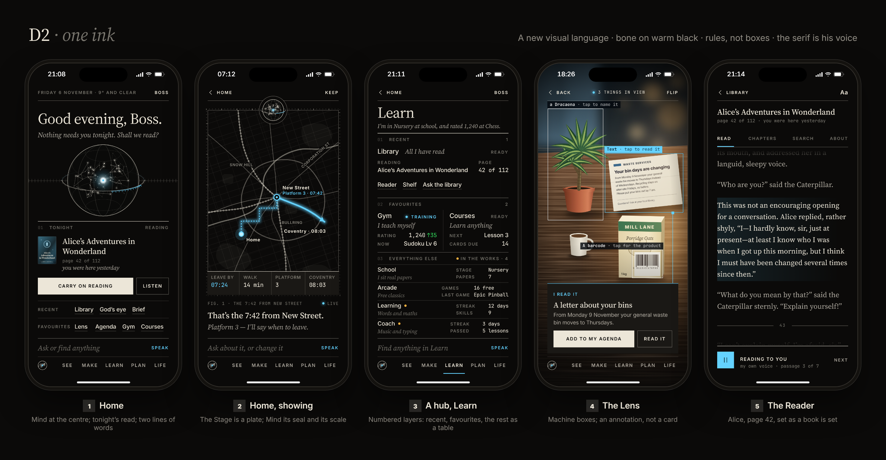

# D2 · One ink

A new visual language that drops the current look entirely: bone ink on warm black, a serif for Ghosty's voice, rules instead of boxes.

## The design

D2 keeps the orb and nothing else. There is no glass, no blur, no shadow, no rounded cell, no row of tab icons: the page is a warm black
(`#0b0a09`), everything on it is set in one ink (bone, `#ece6d8`, at four strengths), and one light (the accent) marks only what is live
now. Three voices do all the work: a serif for what Ghosty says and for titles (the phone's own New York, `ui-serif`, so nothing ships),
the system sans for labels and rows, a mono for readings that must line up. Structure is a printed page's: a masthead of small capitals
over a rule, **numbered sections** under heavy rules (01 Recent, 02 Favourites, 03 Everything else), rows set off by hairlines, a
two-column block divided by a vertical rule, tables for the folded rest, words you press set with an underline. Every corner is
square; the only round things are the orb and a status dot, so Mind is the one soft, lit thing in a hard, orthogonal world. Why it
fits 44 screens, 135 panels and about 150 abilities: typographic hierarchy is the one device that scales to hundreds of rows without
a wall, and the app is mostly lists, tables and readings. Why it fits the Stage: the Stage is a **plate**: a ruled frame with a ruler's
scale along its edge (Mind's equator scale, straightened) and the orb as its seal, a caption in the mono under it ("Fig. 1 · The 7:42
from New Street") and Ghosty's sentence in the serif below, as a book sets a figure. It drops: glass and every shadow, radii, the
tab bar's icons (the areas are five words), cards as boxes, the avatar (it is the word BOSS), the four gauges, and the deck page
(the ask line finds, the index lists).

## The finding rule

Taps are counted from Home. The ask line and the index of areas are at the foot of every screen, so the count is the same from anywhere.

| What he wants | Taps | The path |
| --- | --- | --- |
| A recent screen (Library, God's eye, Brief) | **1** on Home, **2** from anywhere | Home: the underlined word on the Recent line. Anywhere: press the ask line (or the dot), tap the word in the Recent line that opens above the keyboard |
| A favourite (Lens, Agenda, Gym, Courses) | **1** on Home, **2** from anywhere | The Favourites line on Home; elsewhere the same layer from the ask line |
| Any screen | **2** | The area's word in the index (SEE, MAKE, LEARN, PLAN, LIFE; Me is the word BOSS in the masthead), then the row in the hub |
| A panel inside a screen | **3** | Area word, the hub's row, the panel. The Recent block on a hub carries its panels as words (Reader, Shelf, Ask the library) |
| Any of the 150 abilities | a word | Press the ask line, type "chess", tap the first line |

The honest cost: the foot of every screen is 92 points tall (the ask line 48, the index 44) plus the safe area; D2 spends that to keep the
typed word and the areas both visible all the time, where D1 spends none and D3 spends 56.

## Honest costs

My estimates, in days of one strong-tier builder with a reviewer, from the line counts of today's code (`styles.css` 5,846 lines with
608 `border-radius`, 536 `box-shadow` and 83 `backdrop-filter`; `hubcards.ts` 1,017, `areas.ts` 541, `launcher.ts` 339,
`features/core/index.ts` 958, `mind.ts` 997).

### The shell

| Piece | What it takes in D2 | Days |
| --- | --- | --- |
| Tokens and the few components | New tokens; a rule, a section, a row, a table row, a word-button, a plate, a button: seven components restyle everything; no font to ship (`ui-serif` is New York on the phone) | 2.5 |
| The foot | The ask line and the index of words replace the Ask bar and the tab bar (`areas.ts`, `layout.ts`, `core/index.ts`) | 1 |
| Hubs as numbered sections | `CARDS` stays; the three sections, the two-column block, the table | 1.5 |
| The deck folded in | The ask line searches; the hub's table lists; `launcher.ts` goes | 1 |
| Home | The orb needs an **ink mode** in three.js (lines only, one coloured core): the hero is a WebGL canvas, so this is real work, not CSS; the Tonight section; two lines of words | 2 |
| Switcher, jump bar | The switcher is retired (the index is flat); the jump bar is the ask line | 0.5 |
| **The shell without the Stage** | | **8.5** |
| Mind with the Stage | A plate: a rule, a dashed ruler round it, a seal; the same host and Show protocol as the others | 2 |

### Every other screen

The most expensive migration, and the one that makes the whole app one thing fastest. Every screen's visual grammar changes (boxes
become rules, cells become rows, icons become words), so all 37 screens are restyled; but there are only seven components, and the
screens are mostly lists, tables and readings, which this language does best. Estimate: half a day to a day per screen, three to four
weeks pass by pass; the 608 radii, 536 shadows and 83 blurs are removed rather than moved. Two risks, both named: the serif is a
real change of voice for the owner (he picked route C's look; D2 asks him to give up the glass), and the ask line plus the index
put 92 points at the foot of every screen, which is tight on the densest hubs at 390 (Learn fits; Make and Life, with eight cards
each, need the fold to do its job).

## In this folder

`tokens.css` (the real tokens; Ember is the second block: a theme is a swap of the accent block alone, `home-ember-390.png` shows it),
`style.css`, `build.py` (`python3 -I -B docs/build-plan/mockups/directions/d2/build.py` from the repo root, then
`node docs/build-plan/mockups/tools/render.mjs directions/d2`), and the pictures: `home`, `show`, `hub`, `lens`, `reader` and
`shelf` (a sixth small frame) each at `-390.png` and `-440.png`, `home-ember-390.png` and `-440.png`, `contact.png`. The words are the
real ones (`hubcards.ts`'s names and readings, a real station, a real book): *Alice's Adventures in Wonderland*, page 42 of 112, because
its text is public domain and can be set in full (*The Hobbit* is in copyright until 2043; `lib/content.py` swaps it). The serif is
Source Serif in the pictures as the stand-in for New York.
