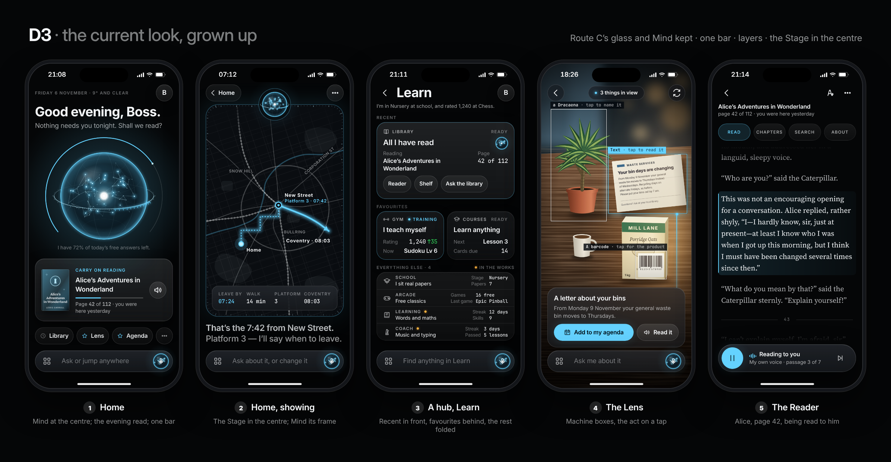

# D3 · The current look, grown up

Route C's glass and Mind kept; less on each screen and more layers; one bar in place of two; the Stage given the centre.

## The design

D3 is today's Ghosty with the overcrowding taken out, not a new look. The graphite canvas, the glass, the cyan light, the system's own
type and Mind in the middle all stay; what goes is the second bar and the four gauges. At the bottom of every screen there is now one
glass capsule in place of the Ask bar over the tab bar: the areas button on the left, one field that is both the chat and the jump bar
("Ask or jump anywhere") in the middle, and a small Mind on the right that talks when pressed. Home is the orb, a greeting, the hour's
card (tonight, the book he was in: "Carry on reading") and one row of the things he used or starred. A hub is three layers by how
often he uses them, not a grid: the recent card in front and raised, the favourites one level back, the rest folded into one stack of
single-line rows; each row still carries its name, its state and its two readings. The Stage takes the centre as a glass panel whose
edge is Mind's own equator scale grown into a bezel, with the orb docked in the top edge like a jewel and the bezel lighting up from
it: Mind is the frame. It fits 44 screens because nothing about the grammar is new (every screen already knows glass, cards, the
accent and mono readings), so a screen migrates by losing things, and it fits the Stage because a glass panel can hold any picture:
a map, a chart, a document, a room. It drops: the tab bar as a row of six, the avatar as a second control (it stays, top right), the
quick switcher (the bar's Mind takes its long press), the Every-screen deck as a page (it becomes the Areas layer), and the four
gauges round the reactor (one ring on the orb keeps "free answers left today").

## The finding rule

Taps are counted from Home. The bar is on every screen, so the count is the same from anywhere.

| What he wants | Taps | The path |
| --- | --- | --- |
| A recent screen (Library, God's eye, Brief) | **1** on Home, **2** from anywhere | Home: the chip. Anywhere: tap the field (the jump layer opens above the keyboard with Recent and Starred), tap the screen |
| A favourite (Lens, Agenda, Gym, Courses) | **1** on Home for the first two, **2** otherwise | The starred chips on Home, or the same jump layer: tap the field, tap it |
| Any screen | **2** | Areas button (the Areas layer lists the six areas, each with its screens as chips: the deck folded in), tap the screen. The hub is a tap on the area's name when he wants the live cards |
| A panel inside a screen | **3** | Areas button, the screen, the panel. The recent card on a hub shows its panels as chips (Reader, Shelf, Ask the library), so those are 3 from Home too |
| Any of the 150 abilities | a word | Tap the field, type "chess", tap the first line. Two taps and a word, from anywhere |

The honest cost: the areas are one tap further than today (a bar of six was 1 tap to an area; here the Areas button plus the tile is 2).
What it buys is the second bar's height back on every screen and a field that is always there.

## Honest costs

My estimates, in days of one strong-tier builder with a reviewer, from the line counts of today's code (`styles.css` 5,846 lines;
`shell/hubcards.ts` 1,017, `areas.ts` 541, `launcher.ts` 339, `switcher.ts` 189, `features/core/index.ts` 958, `mind.ts` 997).

### The shell

| Piece | What it takes in D3 | Days |
| --- | --- | --- |
| Tokens | Today's `--ink`, `--c`, `--cr`, `--hair`, `--rc*` become `tokens.css` almost one for one (the 681 `var(--sf)` and 322 `var(--cr)` uses keep working through aliases) | 0.5 |
| The bar | Merge the Ask bar (`core/index.ts`), `buildTabBar` and the jump field into one component; the Areas layer | 1.5 |
| Hubs as layers | `toolCard` and `CARDS` stay; a three-tier layout, the fold, rows that open in place | 1 |
| The deck folded in | `launcher.ts` and `deckcopy.ts` become the Areas layer's content; the page goes | 1 |
| Home | The orb hero exists; the hour's card, the chips row, the one ring; the four gauges go | 1 |
| Switcher, jump bar | The switcher becomes the Mind button's long press; the jump bar is the field | 0.5 |
| **The shell without the Stage** | | **5.5** |
| Mind with the Stage | The frame is CSS and SVG (a dashed rule round a rounded rectangle, a mask that lights it from the orb); the Stage host and the Show protocol are STARS 164's work and the same in all three directions | 2 |

### Every other screen

The cheapest migration of the three: glass, radii, the accent and mono readings already are the vocabulary, so most of the 37
screens inherit through the tokens and the work is decisions, not CSS: what each screen drops from its top half. The 83 glass
declarations, 608 radii and 536 shadows stay. Estimate: a few hours per dense screen (Home, Gym, School, Library, God's Eye, Settings,
System), minutes for the rest; about two weeks pass by pass, which is what STARS 160 already assumes. Risk: it is the safest and also
the one that least changes how the app feels, which is what he said was wrong ("very overcrowded"); D3 answers that with fewer things
per screen, not with a different feel.

## In this folder

`tokens.css` (the real tokens; Ember is the second block: a theme is a swap of the accent block alone, `home-ember-390.png` shows it),
`style.css` (components and the five screens, written only from the tokens), `build.py` (`python3 -I -B docs/build-plan/mockups/directions/d3/build.py`
from the repo root, then `node docs/build-plan/mockups/tools/render.mjs directions/d3`), and the pictures: `home`, `show`, `hub`, `lens`,
`reader` each at `-390.png` and `-440.png`; and three beyond the five: `shelf` (the Shelf row with a cover, the author and progress, a sixth
small frame), `nav` (the Areas layer opened from a hub: recent and starred on top, every area below with Learn open, the deck folded in:
the proof of "any screen in 2 taps") and `home-ember` (the same Home under Ember); `contact.png` is the five at 390. The words are the real ones (the hub cards' names and readings from `hubcards.ts`; a real station; a real book).
The book is *Alice's Adventures in Wonderland*, page 42 of 112, because its text is in the public domain and can be set in full;
*The Hobbit* is in copyright until 2043. `BOOK` and `READER_TEXT` in `lib/content.py` swap it.
